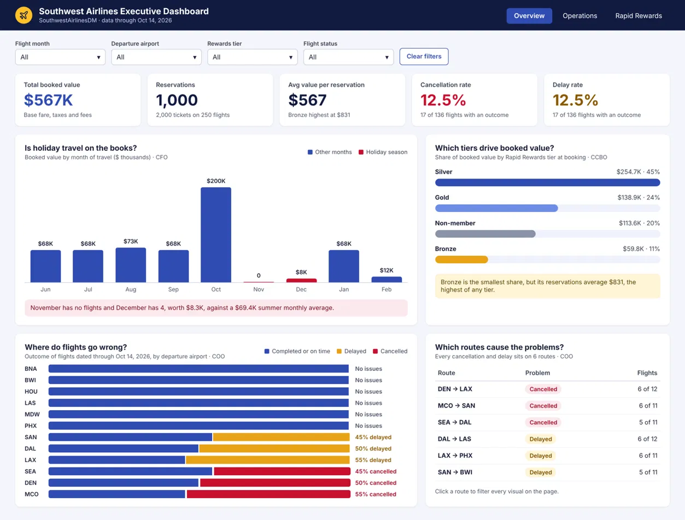

&nbsp;
&nbsp;
&nbsp;
&nbsp;

<h1>Sagal Hassan</h1>

<strong>Business Information &amp; Analytics | University of Denver</strong>

Denver, CO 
720-812-3808 
<a href="mailto:sagalxmohamed@gmail.com">sagalxmohamed@gmail.com</a> 
<a href="https://www.linkedin.com/in/sagalmhassan">LinkedIn</a> | Resume

 

Hi, I'm Sagal! I'm a first-generation college student and a senior at the University of Denver, majoring in Business Information & Analytics, graduating in June 2027.

Most recently, I completed a Sales Excellence Data Analyst internship at Viega LLC, where I built a Power BI dashboard for a 46-person customer service team and automated a weekly process that used to take separate macros in a 50,000-row workbook. I enjoy automating manual processes and making them easier for the people who rely on them.

I am currently looking for full-time roles in consulting, data analytics, or business analytics in Denver with the intention to start june 2027.

**Programming Languages** 
Python &nbsp;·&nbsp; SQL &nbsp;·&nbsp; R &nbsp;·&nbsp; Visual Basic (VBA) &nbsp;·&nbsp; HTML &nbsp;·&nbsp; JavaScript

**Tools and Software** 
Power BI &nbsp;·&nbsp; Tableau &nbsp;·&nbsp; Snowflake &nbsp;·&nbsp; SQL Server &nbsp;·&nbsp; SSIS &nbsp;·&nbsp; RStudio &nbsp;·&nbsp; Shiny &nbsp;·&nbsp; Quarto &nbsp;·&nbsp; Excel &nbsp;·&nbsp; Salesforce &nbsp;·&nbsp; Atlassian Jira &nbsp;·&nbsp; Microsoft Project &nbsp;·&nbsp; Visual Studio Code &nbsp;·&nbsp; Google Workspace

**Certifications** 
Microsoft Office Specialist: Excel, Word, and PowerPoint 
Adult and Pediatric First Aid/CPR/AED

### Southwest Airlines Data Mart & BI

*SQL Server · SSIS · Python (pandas, SciPy) · Power BI*

**Problem:** Reservation, flight, customer, and payment data sat in separate tables, so there was no single view of how bookings, revenue, and flight reliability were performing.

**What I Did:** Designed a 7-table SQL Server data mart using a star schema, with role-playing date and airport dimensions so each reservation could be analyzed by both booking and flight date and by departure and arrival airport, and built an SSIS package to load 25,000+ reservation, flight, customer, and payment records. I analyzed 5 KPIs in Python, including booked value, cancellation rate, and delay rate, ran statistical tests on booking patterns, and presented the findings in a Power BI dashboard and a 5-page stakeholder report. Each visual answers one question for a specific executive, like the CFO or COO.

**Challenge:** Some flights in the data hadn't happened yet but were already marked as cancelled, which would have inflated the cancellation rate. I corrected for this by measuring cancellation and delay rates only on flights with a known outcome.

**Impact:** The dashboard showed that every cancellation and delay came from just six routes, that holiday months had almost no bookings compared with summer, and that Bronze members, the smallest tier, had the highest average reservation value at $831.

### Sales Excellence Data Analyst Intern, Viega LLC

*June 2026 – August 2026*

This past summer at Viega, I built an interactive Power BI dashboard for customer service management, replacing their manual Excel reporting. I partnered with the IT department to combine SAP, Salesforce, and Paycor data in Snowflake, wrote the SQL joins, and built the dashboard. I also automated a 50,000-row territory workbook used by several departments, adding Excel VBA macros and buttons that update specific rows from weekly CRM exports, and trained the CRM specialist to run it.

Day to day, I built Salesforce reports for sales strategy and marketing, set up preloaded events and tasks for sales representatives, helped launch marketing campaigns and an email nurture, and fixed dashboard bugs through Jira tickets. I documented my processes for every major project so the work could be handed off to the data analyst at the end of August.

**Technologies:** Power BI · Snowflake · SQL · SAP · Salesforce · Salesforce Inspector · Excel VBA · Power Automate · Atlassian Jira 
**Soft Skills:** Collaboration · Teaching others · Documentation

*Work from this internship is confidential and covered by an NDA, so it isn't shown here.*

### Order Fulfillment Associate, The Home Depot

*June 2023 – Present*

I've worked at Home Depot throughout college, fulfilling and auditing online orders before they go out for delivery. I check each order's items, quantities, condition, labeling, and staging, and prioritize incoming and next-day orders to meet daily deadlines. When inventory doesn't match, I verify physical stock and coordinate with supervisors and neighboring stores to resolve the issue and keep customers informed.

**Technologies:** Internal order fulfillment and inventory management apps · Handheld devices 
**Soft Skills:** Attention to detail · Prioritization · Customer service · Teamwork

### University of Denver, Daniels College of Business

B.S. in Business Information & Analytics | Expected June 2027

| Course | What I Learned |
|---|---|
| **Analytics Foundations:** INFO 1010 Data Management and Analysis → INFO 1020 Analytics II: Business Statistics and Analysis | Cleaning and organizing data in Excel with pivot tables and Solver, descriptive statistics, and preparing for the Microsoft Office Specialist Excel exam; then probability, confidence intervals, and hypothesis testing, including t-tests, ANOVA, and goodness-of-fit, to support business decisions |
| **INFO 2020:** Business Modeling and Analysis | Multiple regression with binary variables and model assumptions; time series forecasting with moving averages, exponential smoothing, and trend and seasonal analysis; and spreadsheet decision models using what-if analysis, data tables, Goal Seek, and formula auditing |
| **Excel and Automation:** 1031 Advanced Excel Lab → INFO 3100 Automating Business Processes | Advanced Excel and automating tasks with VBA, then Python for data handling, summaries, pivot tables, and basic statistical tests |
| **Database Sequence:** INFO 3140 Foundations of Information Management → INFO 3240 Enterprise Information Management → INFO 3300 Data Warehousing and Business Intelligence | Relational database design with ER diagrams, business rules, and primary and foreign keys; SQL queries using joins, subqueries, GROUP BY, HAVING, and set operations; building databases in SQL Server and Visual Studio; and dimensional modeling, star schemas, and ETL to load a data mart for reporting |
| **INFO 3200:** Data Mining and Visualization | Used R and RStudio to work through the full modeling process, from data preprocessing, PCA, and clustering to time series forecasting and classification with Naive Bayes, decision trees, k-nearest neighbors, logistic regression, and random forests. Evaluated models with confusion matrices and cross-validation, and built a final interactive Shiny app with Quarto reports |
| **INFO 3340:** Project Management and Simulation | Project management principles and building, analyzing, and reporting Monte Carlo simulations |
| **Programming Sequence:** COMP 1351 Introduction to Programming I → COMP 1352 Introduction to Programming II → COMP 1353 Introduction to Data Structures & Algorithms I | Python from fundamentals to object-oriented programming, testing, debugging, and recursion; data structures including stacks, queues, hash tables, trees, and graphs; and runtime analysis |

<a href="#about-me">Back to top</a>

